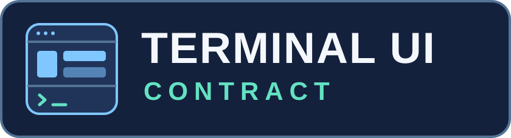

<p align="center">
  
</p>

# terminal-ui-contract

This Rust workspace supports **Ratatui for full-screen TUIs**
and **cliclack for inline CLI prompts**. Both adapters build on the
backend-neutral `terminal-ui-contract` core. The optional
`terminal-ui-runtime` crate handles cooperative read-only refresh.

English · [简体中文](README.zh-CN.md) · [Documentation](docs/README.md) · [MIT](LICENSE)

## Choose a crate

| Use case | Cargo package | Distribution |
| --- | --- | --- |
| Full-screen dashboard, panes, focus, keyboard and mouse | [`terminal-ui-ratatui`](crates/ratatui/README.md) | [crates.io 0.1.0](https://crates.io/crates/terminal-ui-ratatui/0.1.0) |
| Inline select, multi-select, input, confirmation or progress | [`terminal-ui-cliclack`](crates/cliclack/README.md) | Git revision; workspace version 0.1.0 |
| Shared keymaps, focus, display-cell width, locales and semantic themes | [`terminal-ui-contract`](src/lib.rs) | [crates.io 0.2.0](https://crates.io/crates/terminal-ui-contract/0.2.0) |
| Background read-only refresh and last-accepted snapshots | [`terminal-ui-runtime`](crates/runtime/README.md) | [crates.io 0.1.0](https://crates.io/crates/terminal-ui-runtime/0.1.0) |

The adapters are separate Cargo packages and can be used independently.
Each adapter and Runtime depends on Core. Runtime is a dev dependency of
the Ratatui package for its synthetic fixtures. Applications opt in to
Runtime for their own collectors. All workspace packages use Rust 1.97.1
or newer, Edition 2024, and the MIT license.

## Add a dependency

For a full-screen app, start with the Ratatui adapter. Add Core for direct
access to shared types, and add Runtime if your app needs background refresh.

```toml
[dependencies]
terminal-ui-ratatui = "=0.1.0"
terminal-ui-contract = "=0.2.0"
# terminal-ui-runtime = "=0.1.0"
```

For inline prompts, pin the Git commit. The adapter re-exports `Locale`
and `ColorLevel` for `PromptTheme`.

```toml
[dependencies]
terminal-ui-cliclack = { git = "https://github.com/JerrySkywalker/terminal-ui-contract", rev = "a175d97151a9b82d7defa65afe5a9fb5bc56e46e" }
```

If an app passes Core values such as `Locale` between the adapters, use
the same Git URL and revision for both adapters, Core, and Runtime if used.
Cargo treats Git and registry copies of Core as separate crates even
when their versions match. Plan registry publication separately for apps
that depend on the Git-only adapter. See [publication ordering](docs/RELEASE_ORDERING.md).

## Run an example

Run these examples from a checkout of the current source.

```sh
# Full-screen layout rendered to text using Ratatui TestBackend
cargo run --locked -p terminal-ui-ratatui --example gallery -- --size 100x32 --no-color

# Inline prompts in an interactive terminal you own
cargo run --locked -p terminal-ui-cliclack --example menu
cargo run --locked -p terminal-ui-cliclack --example wizard
```

The [Ratatui examples](crates/ratatui/README.md) include an attended terminal
demo. For inline prompts, create `PromptSession` only on interactive paths.
Handle `PromptOutcome::Submitted`, `Cancelled`, and `Error` separately.
The application owns validation and execution of submitted choices. Keep
help, JSON and redirected paths separate, and release one terminal
session before entering the other.

## Develop in this workspace

```sh
cargo fmt --all --check
cargo clippy --workspace --all-targets --locked -- -D warnings
cargo test --workspace --locked
cargo build --workspace --locked
cargo package --workspace --locked
```

[Windows and Linux CI](https://github.com/JerrySkywalker/terminal-ui-contract/actions/workflows/ci.yml)
runs these checks. The [documentation index](docs/README.md) links to source
entry points, keymap configuration, and historical API and qualification records.
